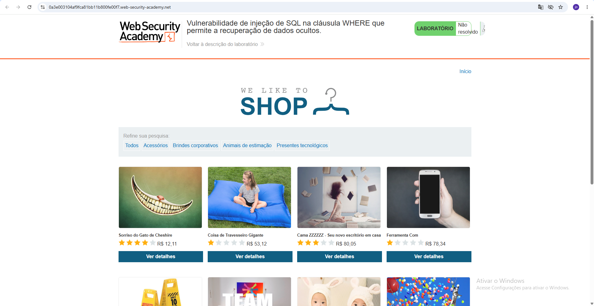
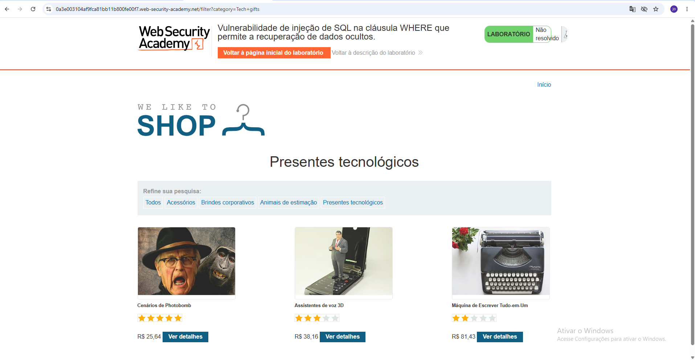
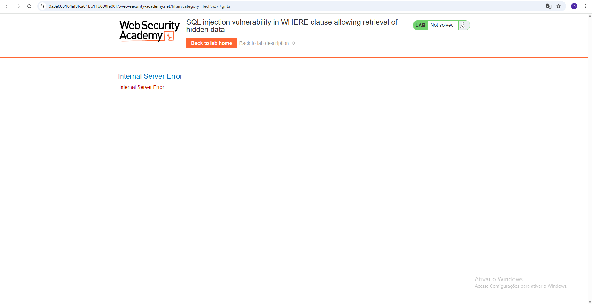
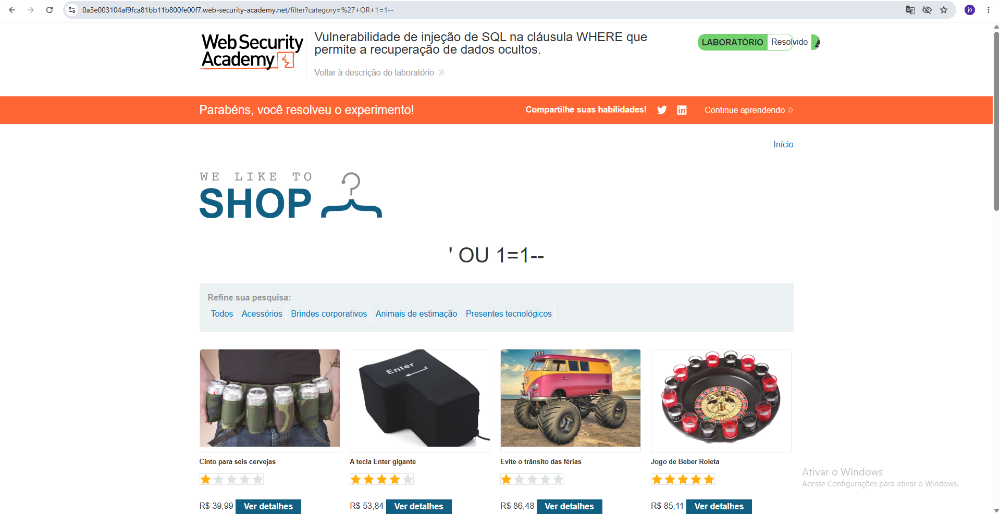

# SQL Injection in WHERE Clause - Retrieving Hidden Data

##  Overview

This report documents an SQL Injection vulnerability identified and exploited in an authorized PortSwigger Web Security Academy lab.

The vulnerability allowed the retrieval of products that were hidden by the application's category filter.

##  Lab Information

- **Platform:** PortSwigger Web Security Academy
- **Lab:** SQL injection vulnerability in WHERE clause allowing retrieval of hidden data
- **Difficulty:** Apprentice
- **Vulnerability Type:** SQL Injection
- **Affected Parameter:** `category`
- **Status:** Successfully solved

##  Vulnerability Details

The application used the `category` URL parameter to filter products.

The parameter was vulnerable to SQL Injection because user-controlled input was interpreted as part of the SQL query without proper handling.

##  Steps to Reproduce

1. Open the authorized PortSwigger lab.
2. Select a product category.
3. Identify the `category` parameter in the URL.
4. Test the parameter by modifying its value.
5. Use a SQL condition that evaluates to true to retrieve products from other categories.
6. Observe the hidden products in the response.

##  Proof of Concept (PoC)

**Vulnerable parameter:**
`category`

**Payload used:**

```sql
' OR 1=1--
```

The injected condition caused the query to return products beyond the originally selected category.

##  Impact

An attacker exploiting this vulnerability could bypass the application's category filtering and retrieve products that were intended to remain hidden.

Depending on the database query and application context, similar vulnerabilities may expose other unauthorized information.

##  Remediation

- Use parameterized queries (prepared statements).
- Avoid concatenating user input directly into SQL queries.
- Validate and handle user input appropriately.
- Apply the principle of least privilege to database accounts.
- Avoid exposing detailed database errors to users.

##  Evidence

### 1. Lab Homepage



### 2. Category Parameter



### 3. SQL Injection Test



### 4. Hidden Data Retrieved



##  References

- [PortSwigger - SQL Injection](https://portswigger.net/web-security/sql-injection)
- [PortSwigger - SQL Injection Labs](https://portswigger.net/web-security/all-labs#sql-injection)
