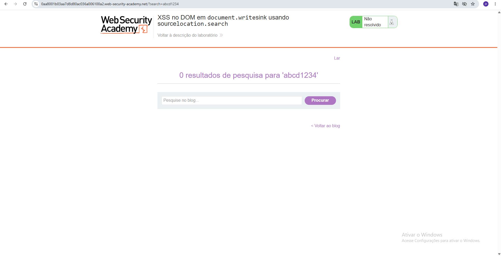
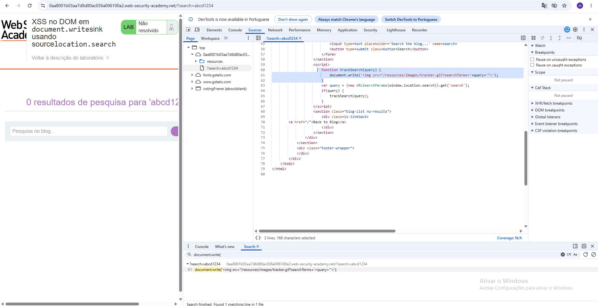
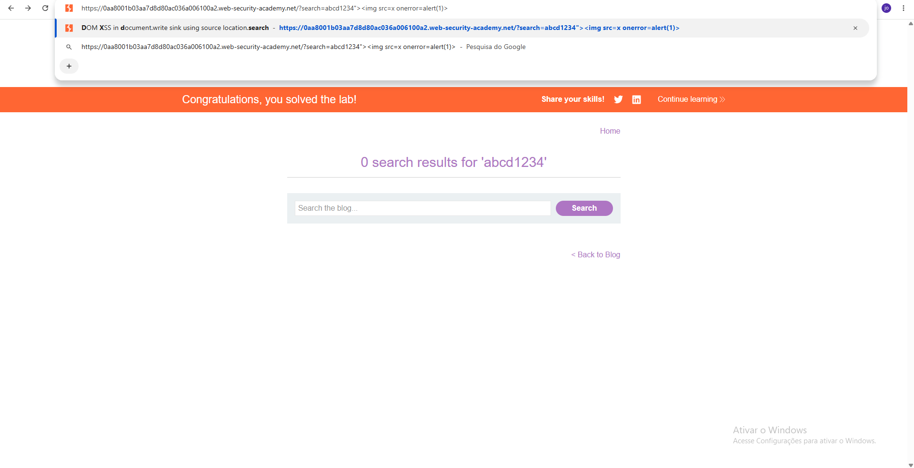
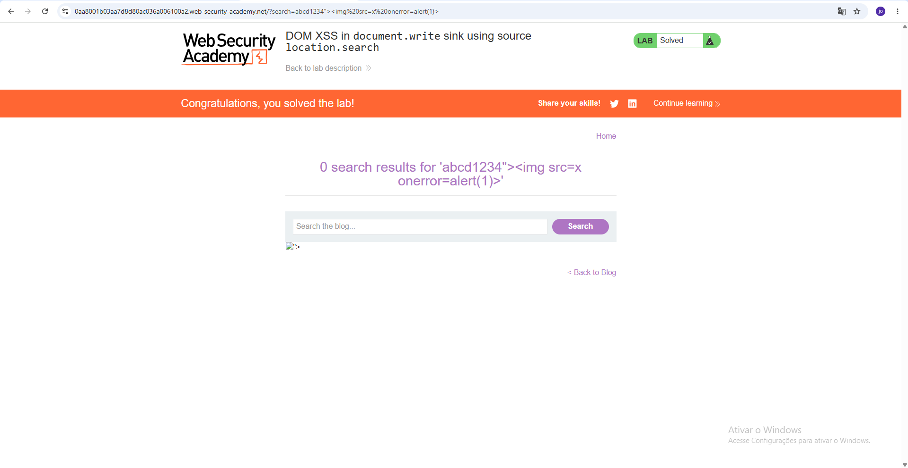

# DOM-Based Cross-Site Scripting (DOM XSS)

## General Information

| **Field** | **Information** |
|---|---|
| Vulnerability | DOM-Based Cross-Site Scripting (DOM XSS) |
| Category | Injection |
| Platform | PortSwigger Web Security Academy |
| Lab | DOM XSS in document.write sink using source location.search |
| Tools | Google Chrome and Chrome DevTools |
| Languages | HTML and JavaScript |
| Status | Solved |
| Difficulty | Apprentice |

## Description

A DOM-Based Cross-Site Scripting vulnerability was identified in the application's search functionality.

The application used the `document.write()` method to dynamically insert user-controlled data from the URL into the HTML document.

The search parameter was concatenated directly into an HTML string without proper sanitization or output encoding, allowing an attacker to inject HTML elements and execute JavaScript in the browser.

## Testing Environment

- Platform: PortSwigger Web Security Academy.
- Browser: Google Chrome.
- Analysis tool: Chrome DevTools.
- Tested functionality: Website search feature.
- URL parameter: `search`.

## Identification Procedure

1. Access the PortSwigger lab.
2. Locate the search functionality.
3. Submit a test search term.
4. Observe the `search` parameter in the URL.
5. Open Chrome DevTools and inspect the JavaScript source code.
6. Search for the `document.write()` method.
7. Identify the `trackSearch(query)` function, which inserts the user-controlled query into an HTML string.

## Vulnerable Code

The following JavaScript code was identified:

```javascript
function trackSearch(query) {
    document.write('');
}
```

The `query` value is concatenated directly into an HTML string and passed to `document.write()`.

## Proof of Concept (PoC)

Payload used:

```html
">
```

The payload was submitted through the `search` URL parameter.

By injecting a new HTML image element and using an `onerror` event handler, JavaScript execution was triggered when the browser attempted to load the invalid image source.

**Result:** JavaScript execution successfully confirmed through an alert dialog displaying `1`.

## Potential Impact

Depending on the application's context, a DOM XSS vulnerability may allow:

- JavaScript execution in users' browsers.
- Manipulation of page content.
- Actions performed on behalf of authenticated users, depending on permissions and security controls.
- Access to information available within the application's context, when not protected by security mechanisms.

The `alert(1)` demonstration confirms JavaScript execution but does not independently demonstrate account compromise or data theft.

## Remediation Recommendations

- Avoid using `document.write()` with untrusted input.
- Use safe DOM manipulation methods such as `textContent` when inserting text.
- Apply context-aware output encoding.
- Validate and properly handle user-controlled URL parameters.
- Implement a restrictive Content Security Policy (CSP) as an additional security layer.

## Evidence

### 1. Search Functionality



### 2. Vulnerable JavaScript Code



### 3. Payload in URL



### 4. JavaScript Execution


### 5. Lab Completion



## References

- [PortSwigger - DOM-Based Cross-Site Scripting](https://portswigger.net/web-security/cross-site-scripting/dom-based)
- [OWASP - DOM-Based XSS](https://owasp.org/www-community/attacks/DOM_Based_XSS)

---

**Disclaimer:** This report documents an educational exercise performed in the controlled PortSwigger Web Security Academy environment. It does not represent a vulnerability discovered in a production system.
