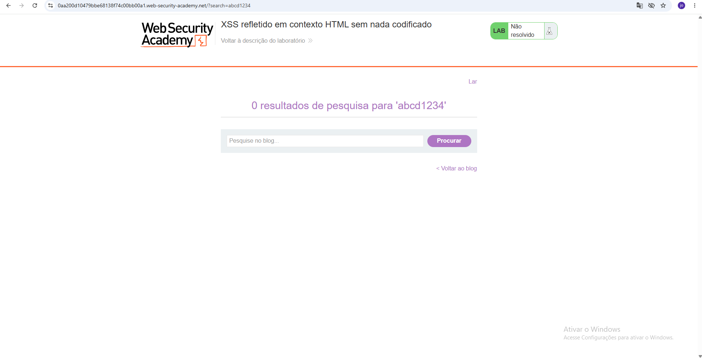
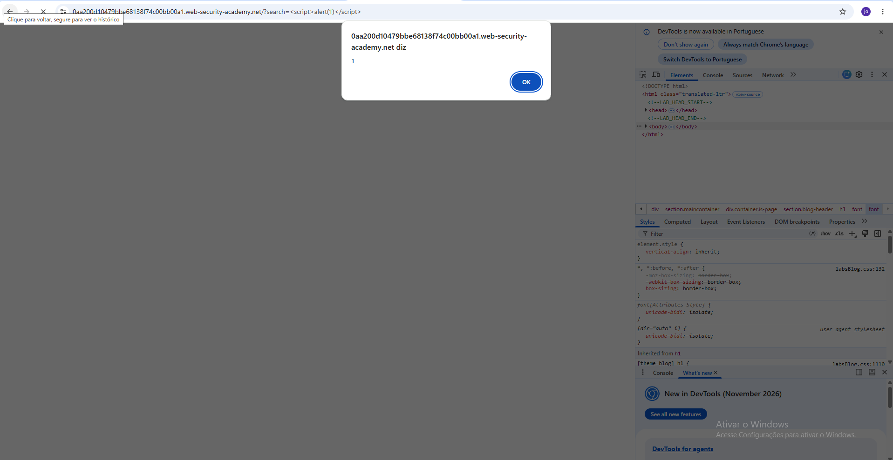
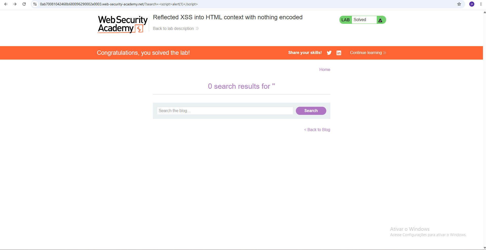

# Reflected Cross-Site Scripting (XSS)

##  Informações gerais

| Campo | Informacao |
|---|---|
| Vulnerabilidade | Reflected Cross-Site Scripting (XSS) |
| Categoria | Injection |
| Plataforma | PortSwigger Web Security Academy |
| Laboratório | Reflected XSS into HTML context with nothing encoded |
| Ferramentas | Google Chrome e DevTools |
| Linguagens | HTML e JavaScript |
| Status | Resolvido |
| Nível | Apprentice |

##  Descrição

Foi identificada uma vulnerabilidade de Reflected Cross-Site Scripting (XSS) em uma funcionalidade de pesquisa.

A aplicação refletia diretamente o conteúdo fornecido pelo usuário na resposta HTML, sem realizar a codificação adequada para o contexto.

A entrada era inserida dentro de um elemento HTML `<h1>`, permitindo a interpretação de código HTML e JavaScript fornecido pelo usuário.

##  Ambiente de testes

- Plataforma: PortSwigger Web Security Academy.
- Navegador: Google Chrome.
- Ferramenta de análise: Chrome DevTools.
- Funcionalidade testada: pesquisa do site.

##  Procedimento de identificação

1. Acessar o laboratório disponibilizado pela PortSwigger.
2. Localizar a funcionalidade de pesquisa.
3. Inserir uma palavra de teste no campo de pesquisa.
4. Inspecionar o HTML utilizando a aba Elements do DevTools.
5. Localizar a entrada refletida na estrutura HTML.
6. Identificar que a entrada estava inserida no contexto HTML, dentro de um elemento `<h1>`.

##  Proof of Concept (PoC)

Payload utilizado:

```html
<script>alert(1)</script>
```

Após inserir o payload no campo de pesquisa, a aplicação refletiu o conteúdo na resposta HTML.

O navegador interpretou a tag `<script>` e executou o JavaScript, exibindo uma janela de alerta com o valor `1`.

**Resultado:** execução de JavaScript confirmada.

##  Impacto potencial

Dependendo do contexto da aplicação, uma vulnerabilidade XSS pode permitir:

- Execução de JavaScript no navegador de outros usuários.
- Manipulação do conteúdo apresentado na página.
- Realização de ações em nome de usuários autenticados, conforme as permissões e proteções existentes.
- Acesso a informações disponíveis ao contexto da aplicação, quando não protegidas por mecanismos de segurança.

A execução de `alert(1)` comprova a possibilidade de execução de JavaScript, mas não demonstra, isoladamente, o comprometimento de contas ou o acesso a informações sensíveis.

##  Recomendações de correção

- Implementar codificação de saída adequada ao contexto HTML.
- Evitar inserir dados não confiáveis diretamente no HTML.
- Utilizar APIs seguras para manipulação do DOM.
- Implementar uma Content Security Policy (CSP) como camada adicional de proteção.
- Validar e tratar adequadamente entradas fornecidas pelos usuários.

##  Evidências

### 1. Reflexão no HTML



### 2. Execução do JavaScript



### 3. Laboratório concluído



##  Referencias

- [PortSwigger - Cross-Site Scripting](https://portswigger.net/web-security/cross-site-scripting)
- [OWASP - Cross Site Scripting](https://owasp.org/www-community/attacks/xss/)

---

**Aviso:** Este relatório documenta uma prática educacional realizada em ambiente controlado da PortSwigger Web Security Academy. Não representa uma vulnerabilidade encontrada em um sistema de produção.
