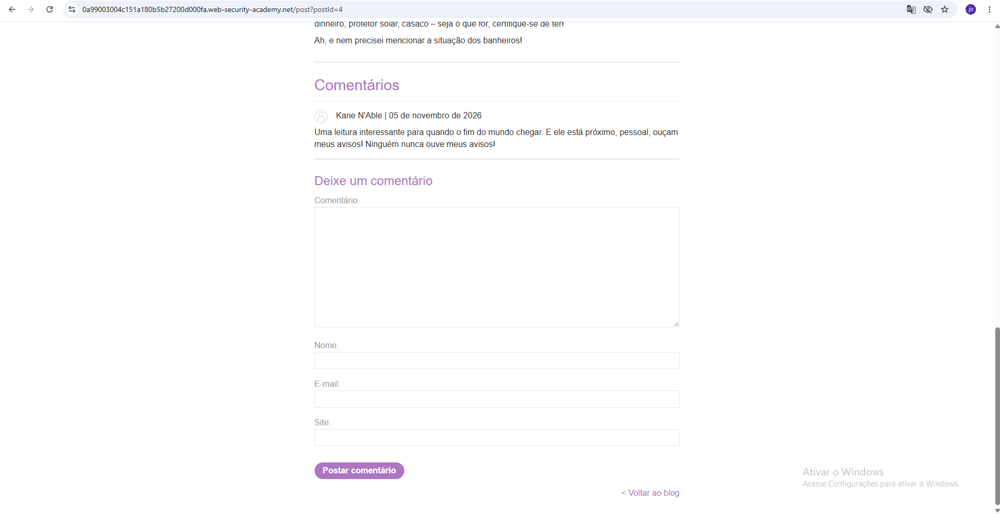
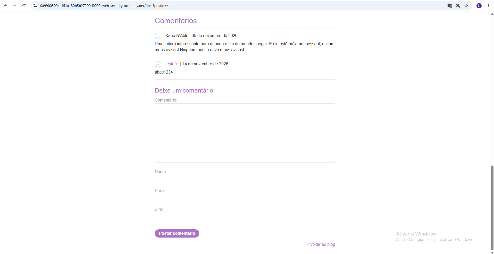
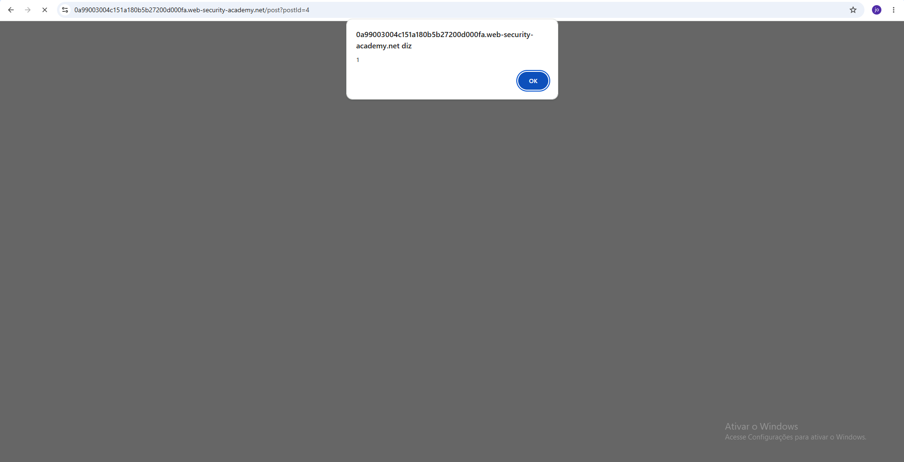
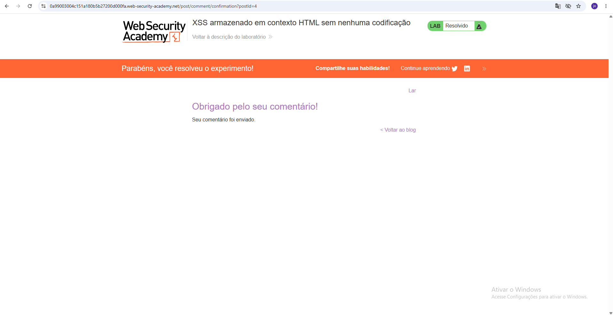

# Stored XSS into HTML Context with Nothing Encoded

## 1. Overview

- **Vulnerability:** Stored Cross-Site Scripting (Stored XSS)
- **Platform:** PortSwigger Web Security Academy
- **Difficulty:** Apprentice
- **Lab status:** Solved
- **Vulnerable functionality:** Blog comment section

## 2. Description

Stored Cross-Site Scripting occurs when an application stores user-controlled input and later displays it to other users without proper sanitization or output encoding.

In this lab, the comment functionality accepted JavaScript code and stored it. When the page displayed the submitted comment, the browser executed the JavaScript.

## 3. Vulnerability Location

- **Page:** Blog post
- **Input field:** Comment
- **Injection point:** Blog comment submission
- **Output location:** Stored comment displayed on the page

## 4. Proof of Concept (PoC)

The following payload was submitted through the comment field:

```html
<script>alert(1)</script>
```

After submitting the comment, the application stored the payload. When the page rendered the comment, the browser executed the JavaScript and displayed an alert containing `1`.

## 5. Steps to Reproduce

1. Open the blog post.
2. Locate the comment submission form.
3. Submit a normal comment to verify that comments are stored.
4. Refresh the page and confirm that the comment remains visible.
5. Submit the JavaScript payload in the comment field.
6. Observe the JavaScript alert.
7. Confirm that the PortSwigger lab is marked as solved.

## 6. Security Impact

An attacker who can exploit this vulnerability may execute JavaScript in the browser of users viewing the affected content.

Depending on the application's security controls and context, this could lead to actions such as unauthorized actions performed through a victim's session or manipulation of page content.

The alert demonstration confirms JavaScript execution, but does not independently demonstrate account compromise or data theft.

## 7. Recommended Remediation

- Apply context-aware output encoding to user-generated content.
- Sanitize HTML input using a well-maintained HTML sanitization library when HTML is allowed.
- Avoid inserting untrusted content into executable contexts.
- Implement a restrictive Content Security Policy (CSP) as an additional security layer.

## 8. Evidence

### Comment Form


### Stored Comment


### Persistence After Refresh


### JavaScript Execution


### Lab Solved


## 9. References

- [PortSwigger Web Security Academy - Cross-site scripting](https://portswigger.net/web-security/cross-site-scripting)
- [PortSwigger - Stored XSS](https://portswigger.net/web-security/cross-site-scripting/stored)

---

**Disclaimer:** This report documents a controlled educational exercise performed in the PortSwigger Web Security Academy environment. No real-world systems were tested.
